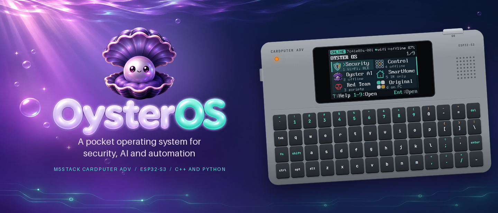
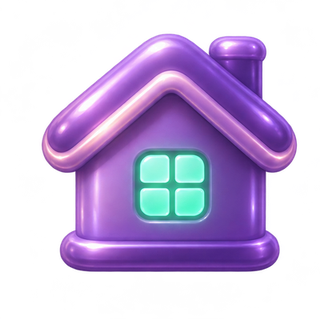
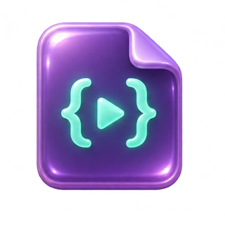
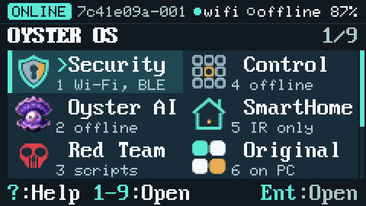
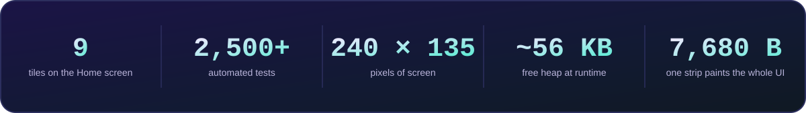
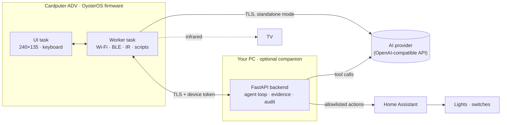

<p align="center">
  <a href="https://martysunshine.github.io/OysterOS-Cardputer/">
    
  </a>
</p>

<p align="center">
  <b>A keyboard-first pocket operating system for the M5Stack Cardputer ADV.</b><br>
  Wi-Fi and Bluetooth recon, an AI assistant that answers over the device's own Wi-Fi, smart-home and PC control,<br>
  Python scripting on the device and an offline calculator — on a 240 × 135 screen.
</p>

<p align="center">
  <a href="https://martysunshine.github.io/OysterOS-Cardputer/"></a>
</p>

<p align="center">
  <a href="LICENSE"></a>
  
  
  
  
  
</p>

<p align="center">
  <a href="#why-it-is-different">Why it is different</a> ·
  <a href="#the-nine-tiles">The nine tiles</a> ·
  <a href="#under-the-hood">Under the hood</a> ·
  <a href="#timeline">Timeline</a> ·
  <a href="#run-it-yourself">Run it yourself</a> ·
  <a href="#documentation">Docs</a>
</p>


## What it is

**OysterOS** turns the [M5Stack Cardputer ADV](https://docs.m5stack.com/en/core/Cardputer-Adv) — an ESP32-S3 with a
tiny keyboard and screen, about the size of a credit card — into a pocket computer with its own operating
system. It boots to its own home screen, joins your Wi-Fi by itself and works **standalone**: the laptop
companion is an optional power-up, not a requirement.

The project covers the whole chain: C++ firmware with a custom UI toolkit, a Python companion backend, an AI
agent loop with typed tools, a screen simulator checked against the firmware, a browser emulator, provisioning over USB
serial and about 2,500 automated tests. It runs on a real Cardputer ADV: it boots, joins Wi-Fi, provisions
over USB and answers AI questions with the laptop switched off.

<p align="center">
  <a href="https://martysunshine.github.io/OysterOS-Cardputer/">
    
  </a>
  <br>
  <sub>The firmware's own drawing code, ported to JavaScript. <a href="https://martysunshine.github.io/OysterOS-Cardputer/">Press the keys yourself</a>.</sub>
</p>

## Why it is different

Pocket gadgets built on microcontrollers usually arrive as a menu of single-purpose tools. OysterOS starts
from a different idea: **treat a keyboard handheld with 8 MB of flash and no extra RAM as a real computer** —
with an operating system, apps, an assistant, a safety model and a test suite — and then make it the *hands*
of an AI agent.

- **The device is the agent's hands, not its brain.** A language model cannot run on a chip with about 56 KB
  of free heap. So the model reasons elsewhere, and the Cardputer is its sensors and actuators: it scans,
  inspects and acts through a strict, typed tool interface.
- **Standalone first.** The device holds its own Wi-Fi credentials and AI key and talks TLS straight to the
  provider. No phone, no laptop, no app.
- **Safety is a feature.** Anything that changes state waits for a physical key press, every remote action
  is allowlisted and logged, and tools that would disturb other people's devices are left out on purpose.

<table>
  <tr>
    <td width="50%" align="center" valign="top">
      <br>
      <b>AI with no phone or laptop</b><br>
      Type a question on the keyboard and read the answer on the screen. The Cardputer joins Wi-Fi on its
      own, keeps its AI key in internal storage and opens the TLS connection itself.
    </td>
    <td width="50%" align="center" valign="top">
      <br>
      <b>An agent with a physical safety catch</b><br>
      With the companion running, the model can only request typed, schema-checked tools. State-changing
      steps wait for a key press — the same key that approves or denies your AI coding assistant's
      permission requests from your pocket.
    </td>
  </tr>
  <tr>
    <td width="50%" align="center" valign="top">
      <br>
      <b>Recon that is safe by design</b><br>
      A passive 2.4 GHz Wi-Fi survey, a wardriving log, Bluetooth LE discovery and GATT inspection of
      devices you enrolled. Findings are kept as evidence. No deauth, no beacon spam, no fake portals.
    </td>
    <td width="50%" align="center" valign="top">
      <br>
      <b>Your home and PC on nine keys</b><br>
      An infrared TV remote, Home Assistant lights, switches and locks behind an allowlist, and a shortcut
      deck that runs approved actions on your PC with confirmation and an audit log.
    </td>
  </tr>
  <tr>
    <td width="50%" align="center" valign="top">
      <br>
      <b>Python on the device</b><br>
      A sandboxed PikaPython interpreter runs scripts from the SD card, with an <code>Oyster</code> module
      for logging, timing and scan results. File hooks fail closed and sleeps are capped, so a script
      cannot hang the device.
    </td>
    <td width="50%" align="center" valign="top">
      <br>
      <b>Engineered like a product</b><br>
      About 2,500 automated tests, a simulator checked against the firmware, a browser emulator, ten
      architecture decision records and a flash script that refuses to run without a verified backup.
    </td>
  </tr>
</table>


## The nine tiles

Home is a two-column grid of nine tiles. The keys <kbd>;</kbd> <kbd>.</kbd> <kbd>,</kbd> <kbd>/</kbd> move
(they carry the arrow legends on the keyboard), <kbd>Enter</kbd> opens, <kbd>1</kbd>–<kbd>9</kbd> jump
straight to a tile, <kbd>?</kbd> shows help and the **G0** button locks the screen to the animated mascot.

| | Tile | What it does | Runs |
|---|---|---|---|
|  | **1 · Security** | Passive Wi-Fi survey with room labels, a live wardriving scan logged to the SD card, a Bluetooth LE explorer with GATT inspection of enrolled devices, saved findings | Standalone |
|  | **2 · Oyster AI** | Type or speak a question. In direct mode the device asks the provider itself; with the companion the AI can also call tools that make the Cardputer scan for it | Standalone · more with the companion |
|  | **3 · Red Team** | Python on the device: the built-in example or any `.py` in `/oyster/scripts/` on the SD card | Standalone |
|  | **4 · Control** | A shortcut deck for your PC: slots 1–9 run allowlisted actions (media keys, lock, Wake-on-LAN, service restart), plus approvals for your AI coding assistant | Companion |
|  | **5 · Smart Home** | An infrared remote for five TV families; rooms, lights, switches and locks through Home Assistant | IR standalone · Home Assistant with the companion |
|  | **6 · Original** | The factory firmware kept safe: what is in the backup slot and how to bring it back | Standalone |
|  | **7 · Settings** · **8 · Help** | Join Wi-Fi from the keyboard, brightness, storage, diagnostics, a key tester; every key explained and the status LED colour legend | Standalone |
|  | **9 · Scratchpad** | A calculator with a history tape and a quick notepad. Lives in RAM only: nothing stored, nothing sent | Standalone |

Every screen below is rendered by a port of the firmware's own drawing code, with the firmware's fonts, icons
and colours.

<p align="center">
  
  
  
  <br><sub>Home · Security · Wi-Fi survey</sub>
</p>

<p align="center">
  
  
  
  <br><sub>Oyster AI, direct mode · Python on the device · Infrared remote</sub>
</p>

<p align="center">
  
  
  
  <br><sub>Scratchpad calculator · Status LED legend · Lock screen</sub>
</p>

<details>
<summary><b>More screens</b></summary>
<br>
<p align="center">
  
  
  
  <br><sub>Asking the provider · Red Team · Smart Home</sub>
</p>

<p align="center">
  
  
  
  <br><sub>Original firmware · Scratchpad · Settings</sub>
</p>
</details>


## Under the hood

<p align="center">
  
</p>



- **Standalone:** the Cardputer holds its own Wi-Fi credentials and AI key, keeps the link up and talks TLS
  straight to the AI provider. No laptop involved.
- **With the companion:** the backend runs an **agent loop**. The model never touches the radio: it can only
  request typed tools (`wifi_survey`, `ble_discover`, `ble_inspect_gatt`, ...). The backend validates each
  request against a schema, turns it into a job, the Cardputer executes it and sends the result back, and
  the model writes its answer from real data.

### Engineering highlights

- **TLS on a shoestring.** mbedTLS wants 16 KB in and 16 KB out per connection, and the buffers cannot be
  shrunk in this framework. Making the standalone AI work meant freeing about 8 KB of internal RAM so the
  hardware SHA engine could verify the provider's elliptic-curve certificate chain.
- **One strip, whole UI.** Every screen region is drawn through a single 240 × 16 sprite (7,680 bytes)
  instead of a 64 KB framebuffer. Nothing redraws unless the screen actually changed.
- **The firmware's screen runs in your browser.** The emulator ports the firmware's band renderer, the
  shape routines, the two bitmap fonts and the calculator to JavaScript, so the online screens come from the
  same drawing logic as the device.
- **A simulator that tests the firmware's UI.** A Python simulator renders every screen in five states;
  parity tests check that its tiles, footers and key hints match the C++ firmware.
- **A swappable brain.** The backend reaches the model through one setting (`AI_BASE_URL`) and the
  OpenAI-compatible API, so the provider is a configuration choice rather than a hard-wired dependency.
- **The original firmware is never lost.** The flash script refuses to write a chip that has no verified
  full backup of that exact chip, and one command writes that backup back.
- **Decisions are written down.** Ten architecture decision records explain the toolchain, the AI provider,
  TLS, persistence, the confirmation model and why the factory firmware is restored from the PC.

## Timeline

<p align="center">
  
</p>

<details>
<summary><b>The timeline as text</b></summary>
<br>

| Date (2026) | Milestone | What happened |
|---|---|---|
| 6 October | The mascot | The oyster and its pearl are drawn |
| 24 October | Design package | Product vision, UI wireframes, screen wiring, design system and the engineering plan (7 commits) |
| 25 October | The big build | Shared contracts and schemas, the backend with its AI agent loop, the companion and Control Deck, a lab device simulator, the 240 × 135 UI simulator, the portable firmware core with host tests, the firmware UI and modules — and the first boot on the real Cardputer ADV (27 commits) |
| 26 October | Going standalone | Status LED, voice questions, joining Wi-Fi from the device, on-device Wi-Fi recon and AI answers over the device's own Wi-Fi (14 commits) |
| 27 October | Scripts and emulator | The Scratchpad, Python scripting on the device and the firmware UI running in a browser (5 commits) |
| 13 November | Public release | Version 0.1.0, open source under the MIT licence |

</details>


## Run it yourself

There are three ways in, from zero install to real hardware.

### 1 · In your browser — nothing to install

Open the **[live emulator](https://martysunshine.github.io/OysterOS-Cardputer/)** and press the keys on the drawn
Cardputer or on your own keyboard. Offline works too: download
[`docs/emulator/index.html`](docs/emulator/index.html), one self-contained file, and open it.

### 2 · On your PC — no device needed

You need Windows 10 or 11, PowerShell, [Git](https://git-scm.com/) and
[Python 3.13](https://www.python.org/downloads/) (3.12 also works). The first setup downloads the pinned
ESP32-S3 toolchain, a few hundred megabytes.

```powershell
git clone https://github.com/Martysunshine/OysterOS-Cardputer.git
cd OysterOS-Cardputer
.\scripts\setup.ps1          # Python environment, tools and the pinned ESP32-S3 toolchain
.\scripts\check.ps1          # lint, about 2,500 tests and a firmware build
.\scripts\ui-sim.ps1         # click through every screen on the PC
```

If PowerShell blocks the scripts, run `Set-ExecutionPolicy -Scope Process -ExecutionPolicy Bypass` once in
the same window. Forked the repository? Clone your fork's URL instead — nothing else changes. The firmware's
host unit tests need a C++ compiler on the PC; `.\scripts\setup.ps1 -InstallWinLibs` installs one.

### 3 · On a Cardputer ADV

You need an M5Stack Cardputer **ADV**, a USB-C cable that carries data, a 2.4 GHz Wi-Fi network and — for
the AI — an API key from an OpenAI-compatible provider (the defaults are set up for Groq).

```powershell
.\scripts\firmware-backup.ps1 -Port COM5                          # full 8 MB backup of your own chip
.\scripts\firmware-flash.ps1  -Port COM5 -Env cardputer-adv-dualboot
.\scripts\oyster-up.ps1                                           # provision Wi-Fi and the AI key, start the companion
```

| Step | What to do |
|---|---|
| Find the port | `.\.venv\Scripts\pio.exe device list` with the Cardputer plugged in (for example `COM5`) |
| Back up first | The flash script insists on a verified backup of your chip; it is your way back to the factory firmware |
| Add your AI key | `setup.ps1` creates `backend\.env` from [`.env.example`](.env.example). Put your key in `AI_API_KEY` and a model id in `AI_MODEL`; `oyster-up.ps1` sends them to the device over USB |
| Optional extras | Home Assistant (`HOME_ASSISTANT_URL`, `HOME_ASSISTANT_TOKEN` and an allowlist from [`examples/home_allowlist.example.json`](examples/home_allowlist.example.json)), web search for the AI, the Windows shortcut deck |
| Go back | `.\scripts\original-restore.ps1 -Port COM5` writes your backup back |

`backend\.env`, certificates, databases and flash backups stay on your machine: [`.gitignore`](.gitignore)
keeps them out of every commit. The full walkthrough is [`docs/SETUP_WINDOWS.md`](docs/SETUP_WINDOWS.md);
if something does not work, see [`docs/TROUBLESHOOTING.md`](docs/TROUBLESHOOTING.md).

## Repository map

| Folder | What lives there |
|---|---|
| [`firmware/`](firmware/) | The PlatformIO project: the UI, one module per tile, radio and TLS clients, and `lib/oyster_core` — portable logic with host-side unit tests |
| [`backend/`](backend/) | The FastAPI companion: agent loop and tool catalogue, evidence store, Control Deck, Home Assistant bridge, voice transcription, provisioning CLI |
| [`simulator/`](simulator/) | The 240 × 135 UI simulator (headless PNG renders or a desktop window) |
| [`docs/emulator/`](docs/emulator/) | The browser emulator: one self-contained page, built by `scripts/gen_emulator.py` |
| [`lab/`](lab/) | A simulated device and a Bluetooth LE lab fixture for testing without hardware |
| [`schemas/`](schemas/) | JSON schemas shared by firmware, backend and tests |
| [`scripts/`](scripts/) | Setup, checks, build, backup, flash, restore, provisioning and the art generators |
| [`tests/`](tests/) | Python tests for the backend, simulator, assets and contracts |
| [`integrations/`](integrations/) | The hook that sends an AI coding assistant's permission requests to the device |
| [`docs/`](docs/) | Architecture, design system, guides and decision records |
| [`assets/`](assets/) | Mascot, icons, loader animation, showcase artwork and their [provenance](assets/PROVENANCE.md) |

## Scope and responsible use

OysterOS is built for learning and for testing **your own** equipment. It does passive recon, inspection of
devices you have enrolled and automation of systems you own. It deliberately **does not** include tools that
disrupt or deceive other people's devices — no deauthentication, beacon spam, Karma or credential-harvesting
portals; in radio range their effect cannot be limited to your own gear.

Secrets stay out of the repository: the AI key lives in `backend/.env` and, for standalone mode, in the
device's internal NVS storage — never in source, logs or on the SD card. What the AI provider receives is
listed in [`docs/PRIVACY.md`](docs/PRIVACY.md); the security model is summarised in
[`SECURITY.md`](SECURITY.md).

## Documentation

The full index is [`docs/README.md`](docs/README.md). Good starting points:

| Read | For |
|---|---|
| [`docs/ARCHITECTURE.md`](docs/ARCHITECTURE.md) | How firmware, backend and simulator fit together |
| [`docs/SETUP_WINDOWS.md`](docs/SETUP_WINDOWS.md) | Setup, flashing and provisioning, step by step |
| [`docs/DESIGN_SYSTEM.md`](docs/DESIGN_SYSTEM.md) · [`docs/UI_SCREEN_MAP.md`](docs/UI_SCREEN_MAP.md) | Colours, type and components; every screen and key |
| [`docs/CONTROL_DECK.md`](docs/CONTROL_DECK.md) · [`docs/HOME_ASSISTANT.md`](docs/HOME_ASSISTANT.md) | PC shortcuts and their safety rules; lights, IR remote and the allowlist |
| [`docs/SCRIPTS.md`](docs/SCRIPTS.md) | The on-device Python sandbox and its `Oyster` module |
| [`docs/VOICE_INPUT.md`](docs/VOICE_INPUT.md) · [`docs/WEB_ACCESS.md`](docs/WEB_ACCESS.md) | Voice questions and optional web search for the AI |
| [`docs/DUAL_BOOT.md`](docs/DUAL_BOOT.md) | The factory firmware: backup, restore and why it is done from the PC |
| [`docs/adr/`](docs/adr/) | Architecture decision records |
| [`docs/OysterOS_Project_Plan.md`](docs/OysterOS_Project_Plan.md) | The original design document |

## Built with

| Layer | Stack |
|---|---|
| Firmware | C++ on Arduino-ESP32 / ESP-IDF with PlatformIO · M5Unified, M5GFX, M5Cardputer · NimBLE-Arduino · ArduinoJson · IRremote · PikaPython |
| Companion | Python · FastAPI · Pydantic · httpx · uvicorn · SQLite |
| Tooling | pytest · ruff · Unity host tests · Pillow · PowerShell |

## Licence and credits

Firmware, backend, simulator, emulator and design by **martin.matysek**, released under the
[MIT licence](LICENSE). The OysterOS name, the mascot and the artwork are the project's own and are not
covered by the code licence; third-party components and their licences are listed in
[`THIRD-PARTY-NOTICES.md`](THIRD-PARTY-NOTICES.md), and how every image was made is recorded in
[`assets/PROVENANCE.md`](assets/PROVENANCE.md). Changes are tracked in [`CHANGELOG.md`](CHANGELOG.md);
contributions are welcome, see [`CONTRIBUTING.md`](CONTRIBUTING.md).

<p align="center">
  <br>
  <sub>Created by martin.matysek</sub>
</p>
