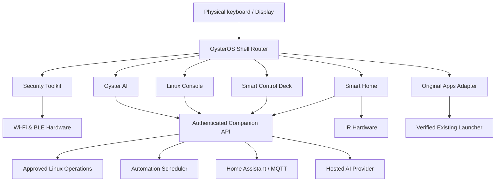

# OysterOS 🦪
### A pocket computer for security, Linux, AI and automations — built for the M5Stack Cardputer ADV

**Project status: planning / UI architecture.** This repository is an educational computer-science project, not a working firmware release yet.

OysterOS turns the Cardputer ADV into a keyboard-first pocket control terminal: survey networks, inspect your own Bluetooth devices, ask an AI assistant, check Linux machines, and launch useful automations from a **Smart Control Deck**.

> **Keep the original software.** Compass, voice tools, PikaScript, GPS menu and other original applications must remain accessible. Our first engineering task is to identify the installed firmware and determine how to add OysterOS without overwriting it. Nothing should be flashed until we have tested a reversible integration strategy. GPS functionality may require external hardware.

## Product concept

Instead of yet another list of unconnected demonstrations, OysterOS provides one consistent shell with:
- **Security Toolkit** — passive Wi-Fi survey, BLE discovery and authorized device diagnostics.
- **Oyster AI** — keyboard/voice questions and explanations through a hosted AI service.
- **Linux Console** — view health, services and logs of computers you administer, via a trusted companion.
- **Smart Control Deck** — physical shortcuts for approved computer actions, smart-home controls and automation workflows.
- **Smart Home** — configurable IR and Home Assistant integrations.
- **Original Apps** — go back to the *actual* original launcher, not a mock copy.
- **Settings & Device Tools** — profiles, network/pairing, diagnostics, battery, and keyboard help.

The Cardputer handles input, display, Wi-Fi/BLE discovery and IR. A **companion service** running on a Linux/Windows PC handles protected actions, scheduling, SSH, AI API calls and integrations.

## Visual identity

**Midnight navy · deep slate panels · seafoam focus · white text · amber warnings.** High contrast, clean geometry, little text per page, large enough selected states for a **240 × 135 landscape** screen.

### 1. Home
```text
╭──────────────────────────────────╮
│ ◈ OYSTER OS            WiFi  86% │
│──────────────────────────────────│
│ > 1 SECURITY       4 CONTROL    │
│   2 OYSTER AI      5 SMART HOME │
│   3 LINUX          6 ORIGINAL   │
│──────────────────────────────────│
│ [↑↓] Move [Enter] Open [?] Help │
╰──────────────────────────────────╯
```

### 2. Security Toolkit
```text
╭──────────────────────────────────╮
│ SECURITY                  01/03  │
│──────────────────────────────────│
│ > Wi-Fi Survey                    │
│   Bluetooth Explorer              │
│   Saved Findings                  │
│──────────────────────────────────│
│ [Enter] Open        [Back] Home   │
╰──────────────────────────────────╯
```
**Wi-Fi Survey** → scanning → list (SSID / RSSI) → network detail (channel, BSSID, security) → save finding → optional AI explanation.

**BLE Explorer** → advertisement list → device detail (signal, services if available) → authorized GATT inspection → save result.

### 3. Oyster AI
```text
╭──────────────────────────────────╮
│ OYSTER AI          Connected  ●  │
│──────────────────────────────────│
│ Ask about a scan, service or log │
│ > Why is this Wi-Fi so weak?      │
│                                   │
│ [Enter] Send    [Mic] Record*     │
╰──────────────────────────────────╯
```
Keyboard compose → submit → waiting indicator → answer pages. Context attachment to scan or service result only after review. Microphone support is a later-phase feature.

### 4. Linux Console
```text
╭──────────────────────────────────╮
│ LINUX             HOST: MINI-PC  │
│──────────────────────────────────│
│ > System health        ● Online  │
│   Services                       │
│   Recent logs                    │
│   Approved tasks                 │
│──────────────────────────────────│
│ [Enter] Inspect      [Back] Home │
╰──────────────────────────────────╯
```
Host selection → approved capability → request to authenticated companion → progress → result or actionable error. **No arbitrary shell field on the Cardputer by default.**

### 5. Smart Control Deck
```text
╭──────────────────────────────────╮
│ CONTROL DECK       PROFILE: HOME │
│──────────────────────────────────│
│ > 1 Check server                  │
│   2 Start dev stack              │
│   3 Red Orca status              │
│   4 Backup workflow              │
│──────────────────────────────────│
│ [Enter] Run      [Back] Home     │
╰──────────────────────────────────╯
```
Profile → macro list → parameter prompt if required → **confirmation for impactful actions** → queued/running/success/failure → history. Physical number keys act as *context-specific* shortcuts; they do not conflict with Home selection.

### 6. Smart Home
```text
╭──────────────────────────────────╮
│ SMART HOME             ROOM: DESK│
│──────────────────────────────────│
│ > Lights             OFF         │
│   IR remote                      │
│   Scenes                         │
│   Automations                    │
│──────────────────────────────────│
│ [Enter] Choose     [Back] Home   │
╰──────────────────────────────────╯
```
Device/scene selection → capability detail → execute on approved home-integration target → result. Show unavailable states if hardware/hub isn't connected.

### 7. Original Apps
An explicit **Original Apps** entry invokes the *genuine existing launcher* if the installed firmware exposes a supported return/launch path. If coexistence is not verified, disable this entry with an explanatory screen in prototypes — **never fake a successful switch.**

## Navigation contract

| Interaction | Expected behavior |
|---|---|
| Up / Down | Move visible focus |
| Enter | Open / select |
| Back | Return one screen, without losing an in-progress task silently |
| Home | Return to OysterOS root |
| 1–6 on Home | Open the six main destinations |
| 1–9 in Control Deck | Select/run assigned macro, subject to confirmation |
| Help | Show current-screen controls |
| Original Apps | Switch via verified launcher integration only |

Physical key combinations must be discovered and tested against the firmware installed on **this** Cardputer ADV. Back/Home are **logical actions** in the input layer until the actual keyboard mappings and launcher API are known. Avoid trapping users in apps as happened with the original Compass program.

## How the modules connect


**Data flow:** UI event → screen router → module controller → hardware driver *or* API client → typed result → loading/error/confirmation state → screen render. Each module has a real handler or is visibly marked **Not implemented**; no decorative buttons pretending to work.

## Engineering approach

| Layer | Responsibilities |
|---|---|
| Input | Keyboard scanning, debouncing, key-map, Back/Home routing |
| UI / Router | Screens, focus, modal prompts, status, navigation stack |
| Controllers | Wi-Fi, BLE, AI, Linux, Deck, Smart Home, Original Apps |
| Drivers | Display, radio, mic, IR, battery |
| API client | Pairing, authenticated HTTPS requests, retries and offline errors |
| Companion | Allowlisted task runner, SSH access, scheduler, AI gateway, home integrations |
| Persistence | Device preferences and bounded findings cache; companion profiles/history |

Firmware candidates: **PlatformIO + C++** with device-specific M5Stack libraries, or the plugin/app framework supported by the current launcher. Companion candidate: **FastAPI + SQLite + scheduler**, with tested Linux/Windows adapters. Final stack must be chosen **after firmware audit**, not assumed.

### Repository roadmap
- [ ] Phase 0: Firmware identification, inventory, backup/recovery assessment, coexistence proof
- [ ] Phase 1: UI shell + 240×135 views + reliable Back/Home + Original Apps adapter
- [ ] Phase 2: Wi-Fi/BLE tools and finding storage
- [ ] Phase 3: Companion pairing and read-only Linux health checks
- [ ] Phase 4: Control Deck macros, logs and confirmations
- [ ] Phase 5: Smart Home and scheduled automations
- [ ] Phase 6: Oyster AI, context ingestion and optional voice input
- [ ] Phase 7: On-device testing, reliability, docs and release build

## Safety by design
Passive network discovery by default; deeper inspection only on owned or explicitly authorized assets. Linux and automation actions use **backend allowlists**, least-privilege accounts, authentication, timeouts, confirmation of impactful actions and audit trails. AI suggestions cannot execute arbitrary commands. Never commit credentials.

## Documentation
Start with the [Engineering Plan](docs/OysterOS_Project_Plan.md) for full implementation wiring, then consult the [UI/UX Design System](docs/DESIGN_SYSTEM.md), [Development Roadmap](docs/DEVELOPMENT_ROADMAP.md), and [Firmware Preservation Audit](docs/HARDWARE_AUDIT_TEMPLATE.md). The first implementation tasks are in [GitHub Issues](../../issues).

## Getting started
1. Photograph or record the current boot and home screens, firmware version and installed apps.
2. Check the precise installed launcher framework before selecting a deployment method.
3. Prototype UI screens and the companion without modifying the device.
4. Add device firmware only once Original Apps preservation is validated.

**Principle:** Make something useful, make every control work, and never sacrifice the original device software for an untested experiment.
