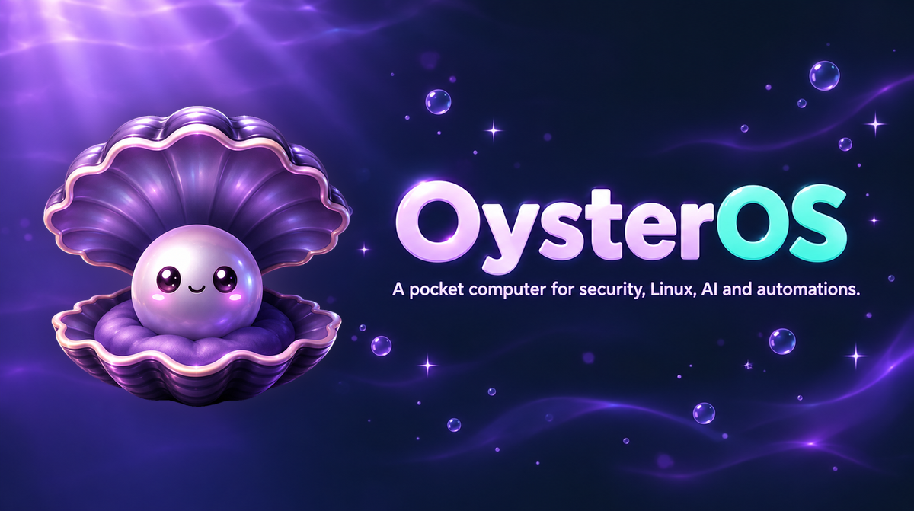
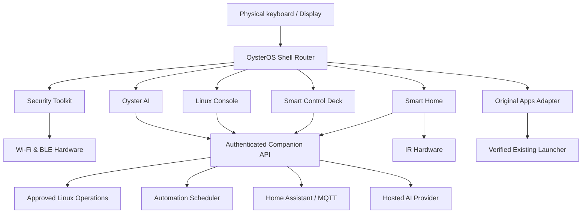

# OysterOS 🦪
### A pocket computer for security, Linux, AI and automations — built for the M5Stack Cardputer ADV



**Project status: early implementation, nothing verified on hardware yet.** This repository is an educational computer-science project, not a firmware release.

OysterOS turns the Cardputer ADV into a keyboard-first pocket control terminal: survey networks, inspect your own Bluetooth devices, ask an AI assistant, check Linux machines, and launch useful automations from a **Smart Control Deck**.

> **Keep the original software.** Compass, voice tools, PikaScript, GPS menu and other original applications must remain accessible. Our first engineering task is to identify the installed firmware and determine how to add OysterOS without overwriting it. Nothing should be flashed until we have tested a reversible integration strategy. GPS functionality may require external hardware.

## Status: what exists today and what is still vision

The implementation was written and compiled on a PC; **no Cardputer has been attached, so nothing is verified on the device.** The rest of this page is the product vision.

| Module of the vision | Today |
|---|---|
| Security Toolkit | **Wi-Fi Survey** and **BLE Explorer** are written in the firmware (Home > Security; 2.4 GHz only; BLE inspection of locally enrolled lab targets only). Findings are stored as evidence on the microSD card and in the backend, and listed under **Saved Findings**. Unverified on hardware. |
| Oyster AI | Runs through the companion backend (FastAPI on your PC, Groq through an OpenAI-compatible API); the **Oyster AI** tile on the device asks and shows the answer. The Groq adapter is tested against mocked HTTP and a fake provider, and in the lab demo against a real Groq model with a simulated device; it has not run with the Cardputer yet. Text only. |
| Linux Console, Smart Control Deck, Smart Home, Original Apps | **Not built on the device.** Their Home tiles are greyed out and open "Not available in this build"; they never show fake screens. The backend already has a read-only host-health API and an allowlisted Control Deck job API, both with mock executors only ([Companion API](docs/COMPANION_API.md), [Control Deck](docs/CONTROL_DECK.md)). |
| Settings & Device Tools | Backend state, storage, diagnostics, keyboard help and a key tester, plus USB serial provisioning, are written, unverified. |

**The current firmware build is a full-flash image.** It carries its own partition table without OTA and replaces the factory firmware, the launcher and the original apps. That does not yet meet the principle above ("keep the original software"): a launcher-compatible build has not been made. Until then the safety net is a verified backup: `scripts\firmware-flash.ps1` refuses to flash a chip that has no matching backup made by `scripts\firmware-backup.ps1`. Details and the reconciliation with the design constraints: [`docs/INTEGRATION.md`](docs/INTEGRATION.md).

## Implementation

The working code is called **Oyster Pocket**. It lives in `firmware/` (PlatformIO, C++), `backend/` (FastAPI), `lab/` (device simulator and BLE lab fixture), `simulator/` (240x135 screen simulator), `schemas/`, `scripts/` and `tests/`.

| Read | For |
|---|---|
| [`docs/POCKET_CORE.md`](docs/POCKET_CORE.md) | What Oyster Pocket does, its scope and limits, quick start, execution modes, repository layout |
| [`docs/INTEGRATION.md`](docs/INTEGRATION.md) | How this vision and the implementation fit: module and milestone map, API comparison, keyboard, constraints, open decisions |
| [`docs/CAPABILITY_MATRIX.md`](docs/CAPABILITY_MATRIX.md) | What works where (simulator, firmware, backend) and what does not exist |
| [`docs/SETUP_WINDOWS.md`](docs/SETUP_WINDOWS.md) | Step-by-step setup on Windows, including the backup before the first flash |
| [`docs/UI_SCREEN_MAP.md`](docs/UI_SCREEN_MAP.md) | The design's screen identifiers mapped to firmware screens, the navigation tree and the proposed keys |
| [`docs/PRIVACY.md`](docs/PRIVACY.md) | What the AI provider receives, what is masked, what is never sent |

**The OysterOS look.** The firmware screens follow the project's [UI/UX Design System](docs/DESIGN_SYSTEM.md): its palette, spacing and type sizes are constants in `firmware/include/ui_theme.h`, the Home screen is headed `OYSTER OS` with a tile grid, and a boot splash is drawn once at start-up. The mascot, the module icons and the splash are static art converted to RGB565 by `scripts/gen_assets.py`, and a six-frame loader animation (6 fps, flash-resident) plays only while the firmware starts. The mascot is the project's own artwork; the icons and the loader's motion reference are AI-generated; [`assets/PROVENANCE.md`](assets/PROVENANCE.md) records the models and prompts. Every region is painted through one 240 x 16 sprite (7,680 B of RAM), not a full-screen buffer. None of this has been seen on a real display, and the key bindings (including Home and Help) are proposals until tried with **Settings > Key tester**.

## Product concept

Instead of yet another list of unconnected demonstrations, OysterOS provides one consistent shell with:
- **Security Toolkit** — passive Wi-Fi survey, BLE discovery and authorized device diagnostics.
- **Oyster AI** — keyboard/voice questions and explanations through a hosted AI service.
- **Linux Console** — view health, services and logs of computers you administer, via a trusted companion.
- **Smart Control Deck** — physical shortcuts for approved computer actions, smart-home controls and automation workflows.
- **Smart Home** — configurable IR and Home Assistant integrations.
- **Original Apps** — go back to the *actual* original launcher, not a mock copy.
- **Settings & Device Tools** — profiles, network/pairing, diagnostics, battery, and keyboard help.

The Cardputer handles input, display, Wi-Fi/BLE discovery and IR. A **companion service** running on a Linux/Windows PC handles protected actions, scheduling, SSH, AI API calls and integrations.

## Visual identity

**Midnight navy · deep slate panels · seafoam focus · white text · amber warnings.** High contrast, clean geometry, little text per page, large enough selected states for a **240 × 135 landscape** screen.

### 1. Home
```text
╭──────────────────────────────────╮
│ ◈ OYSTER OS            WiFi  86% │
│──────────────────────────────────│
│ > 1 SECURITY       4 CONTROL    │
│   2 OYSTER AI      5 SMART HOME │
│   3 LINUX          6 ORIGINAL   │
│──────────────────────────────────│
│ [↑↓] Move [Enter] Open [?] Help │
╰──────────────────────────────────╯
```

### 2. Security Toolkit
```text
╭──────────────────────────────────╮
│ SECURITY                  01/03  │
│──────────────────────────────────│
│ > Wi-Fi Survey                    │
│   Bluetooth Explorer              │
│   Saved Findings                  │
│──────────────────────────────────│
│ [Enter] Open        [Back] Home   │
╰──────────────────────────────────╯
```
**Wi-Fi Survey** → scanning → list (SSID / RSSI) → network detail (channel, BSSID, security) → save finding → optional AI explanation.

**BLE Explorer** → advertisement list → device detail (signal, services if available) → authorized GATT inspection → save result.

### 3. Oyster AI
```text
╭──────────────────────────────────╮
│ OYSTER AI          Connected  ●  │
│──────────────────────────────────│
│ Ask about a scan, service or log │
│ > Why is this Wi-Fi so weak?      │
│                                   │
│ [Enter] Send    [Mic] Record*     │
╰──────────────────────────────────╯
```
Keyboard compose → submit → waiting indicator → answer pages. Context attachment to scan or service result only after review. Microphone support is a later-phase feature.

### 4. Linux Console
```text
╭──────────────────────────────────╮
│ LINUX             HOST: MINI-PC  │
│──────────────────────────────────│
│ > System health        ● Online  │
│   Services                       │
│   Recent logs                    │
│   Approved tasks                 │
│──────────────────────────────────│
│ [Enter] Inspect      [Back] Home │
╰──────────────────────────────────╯
```
Host selection → approved capability → request to authenticated companion → progress → result or actionable error. **No arbitrary shell field on the Cardputer by default.**

### 5. Smart Control Deck
```text
╭──────────────────────────────────╮
│ CONTROL DECK       PROFILE: HOME │
│──────────────────────────────────│
│ > 1 Check server                  │
│   2 Start dev stack              │
│   3 Red Orca status              │
│   4 Backup workflow              │
│──────────────────────────────────│
│ [Enter] Run      [Back] Home     │
╰──────────────────────────────────╯
```
Profile → macro list → parameter prompt if required → **confirmation for impactful actions** → queued/running/success/failure → history. Physical number keys act as *context-specific* shortcuts; they do not conflict with Home selection.

### 6. Smart Home
```text
╭──────────────────────────────────╮
│ SMART HOME             ROOM: DESK│
│──────────────────────────────────│
│ > Lights             OFF         │
│   IR remote                      │
│   Scenes                         │
│   Automations                    │
│──────────────────────────────────│
│ [Enter] Choose     [Back] Home   │
╰──────────────────────────────────╯
```
Device/scene selection → capability detail → execute on approved home-integration target → result. Show unavailable states if hardware/hub isn't connected.

### 7. Original Apps
An explicit **Original Apps** entry invokes the *genuine existing launcher* if the installed firmware exposes a supported return/launch path. If coexistence is not verified, disable this entry with an explanatory screen in prototypes — **never fake a successful switch.**

## Navigation contract

| Interaction | Expected behavior |
|---|---|
| Up / Down | Move visible focus |
| Enter | Open / select |
| Back | Return one screen, without losing an in-progress task silently |
| Home | Return to OysterOS root |
| 1–6 on Home | Open the six main destinations |
| 1–9 in Control Deck | Select/run assigned macro, subject to confirmation |
| Help | Show current-screen controls |
| Original Apps | Switch via verified launcher integration only |

Physical key combinations must be discovered and tested against the firmware installed on **this** Cardputer ADV. Back/Home are **logical actions** in the input layer until the actual keyboard mappings and launcher API are known. Avoid trapping users in apps as happened with the original Compass program.

## How the modules connect


**Data flow:** UI event → screen router → module controller → hardware driver *or* API client → typed result → loading/error/confirmation state → screen render. Each module has a real handler or is visibly marked **Not implemented**; no decorative buttons pretending to work.

## Engineering approach

| Layer | Responsibilities |
|---|---|
| Input | Keyboard scanning, debouncing, key-map, Back/Home routing |
| UI / Router | Screens, focus, modal prompts, status, navigation stack |
| Controllers | Wi-Fi, BLE, AI, Linux, Deck, Smart Home, Original Apps |
| Drivers | Display, radio, mic, IR, battery |
| API client | Pairing, authenticated HTTPS requests, retries and offline errors |
| Companion | Allowlisted task runner, SSH access, scheduler, AI gateway, home integrations |
| Persistence | Device preferences and bounded findings cache; companion profiles/history |

Firmware candidates: **PlatformIO + C++** with device-specific M5Stack libraries, or the plugin/app framework supported by the current launcher. Companion candidate: **FastAPI + SQLite + scheduler**, with tested Linux/Windows adapters. Final stack must be chosen **after firmware audit**, not assumed.

### Repository roadmap
- [ ] Phase 0: Firmware identification, inventory, backup/recovery assessment, coexistence proof
- [ ] Phase 1: UI shell + 240×135 views + reliable Back/Home + Original Apps adapter
- [ ] Phase 2: Wi-Fi/BLE tools and finding storage
- [ ] Phase 3: Companion pairing and read-only Linux health checks
- [ ] Phase 4: Control Deck macros, logs and confirmations
- [ ] Phase 5: Smart Home and scheduled automations
- [ ] Phase 6: Oyster AI, context ingestion and optional voice input
- [ ] Phase 7: On-device testing, reliability, docs and release build

## Safety by design
Passive network discovery by default; deeper inspection only on owned or explicitly authorized assets. Linux and automation actions use **backend allowlists**, least-privilege accounts, authentication, timeouts, confirmation of impactful actions and audit trails. AI suggestions cannot execute arbitrary commands. Never commit credentials.

## Secrets

The AI key lives only in `backend/.env` on your PC; it is never sent to the Cardputer, written to the SD card or logged. Never commit `backend/.env`, device tokens, Wi-Fi passwords, raw surveys, SD dumps or the flash backups in `_backups/` (they can contain credentials of the original firmware). What the AI provider receives is listed in [`docs/PRIVACY.md`](docs/PRIVACY.md); how the admin API and the device API are separated is in [`docs/POCKET_CORE.md`](docs/POCKET_CORE.md#secrets).

## Documentation

The design package (the specification):

| Document | Use it for |
|---|---|
| [Engineering Plan](docs/OysterOS_Project_Plan.md) | Full implementation wiring, UI contract (sections 3, 4, 10, 11), API sketch, acceptance tests |
| [UI/UX Design System](docs/DESIGN_SYSTEM.md) | Tokens, spatial sizing, components, screen identifiers |
| [Development Roadmap](docs/DEVELOPMENT_ROADMAP.md) | Milestones M0-M8 and the MVP acceptance list |
| [Firmware Preservation Audit](docs/HARDWARE_AUDIT_TEMPLATE.md) | Checklist to complete before anything is flashed |

The implementation (Oyster Pocket):

| Document | Use it for |
|---|---|
| [`docs/INTEGRATION.md`](docs/INTEGRATION.md) | How the design package and the implementation fit |
| [`docs/POCKET_CORE.md`](docs/POCKET_CORE.md) | Overview, scope, quick start, execution modes |
| [`docs/SETUP_WINDOWS.md`](docs/SETUP_WINDOWS.md) | Step-by-step setup, backup, flashing, provisioning, demo |
| [`docs/ARCHITECTURE.md`](docs/ARCHITECTURE.md) | How the parts fit together |
| [`docs/UI_SCREEN_MAP.md`](docs/UI_SCREEN_MAP.md) | Design screen identifiers against firmware screens, navigation tree, proposed keys |
| [`docs/CAPABILITY_MATRIX.md`](docs/CAPABILITY_MATRIX.md) | What works where, and what does not exist yet |
| [`docs/HARDWARE_VERIFICATION.md`](docs/HARDWARE_VERIFICATION.md) | Checklist for the real device, with a results table |
| [`docs/TROUBLESHOOTING.md`](docs/TROUBLESHOOTING.md) | Certificates, COM ports, download mode, restoring the backup |
| [`docs/SIMULATOR.md`](docs/SIMULATOR.md) | The 240x135 screen simulator: run it, routes and states, what is and is not verified |
| [`docs/COMPANION_API.md`](docs/COMPANION_API.md) | Pairing and read-only host health (mock adapters) |
| [`docs/CONTROL_DECK.md`](docs/CONTROL_DECK.md) | Allowlisted jobs with local confirmation (mock executor) |
| [`docs/API.md`](docs/API.md), [`docs/PROVISIONING.md`](docs/PROVISIONING.md), [`docs/BLE_LAB_PROFILE.md`](docs/BLE_LAB_PROFILE.md) | HTTP API, USB serial provisioning, lab GATT profile |
| [`docs/PRIVACY.md`](docs/PRIVACY.md), [`docs/BUILD_MATRIX.md`](docs/BUILD_MATRIX.md), [`docs/adr/`](docs/adr/) | Data sent to the AI provider, pinned toolchain, architecture decisions |

The first implementation tasks can be tracked in the GitHub Issues of the repository.

## Getting started

Nothing here modifies the Cardputer until step 5. Commands run in PowerShell from the repository root; the full walkthrough is [`docs/SETUP_WINDOWS.md`](docs/SETUP_WINDOWS.md).

1. **By hand, before anything else:** photograph or record the current boot and home screens, firmware version and installed apps, and fill in the [Firmware Preservation Audit](docs/HARDWARE_AUDIT_TEMPLATE.md). Check which launcher framework is installed before choosing a deployment method.
2. Install the tools and run the automated checks (no device needed):
   ```powershell
   .\scripts\setup.ps1
   .\scripts\check.ps1
   ```
3. Run the companion backend and the simulated device (two windows):
   ```powershell
   .\scripts\backend.ps1
   .\scripts\sim.ps1 -Scenario success -AutoConfirm
   ```
4. Build the firmware (no device needed): `.\scripts\firmware-build.ps1`
5. **Only with the audit done:** back up the whole flash, then flash. The flash script refuses without a verified backup for that chip.
   ```powershell
   .\scripts\firmware-backup.ps1 -Port COM5     # manual step - unverified until run
   .\scripts\firmware-flash.ps1 -Port COM5      # manual step - unverified until run
   ```
   Restoring the backup: [`docs/TROUBLESHOOTING.md`](docs/TROUBLESHOOTING.md#restoring-your-own-backup-esptool).

**Principle:** Make something useful, make every control work, and never sacrifice the original device software for an untested experiment.
