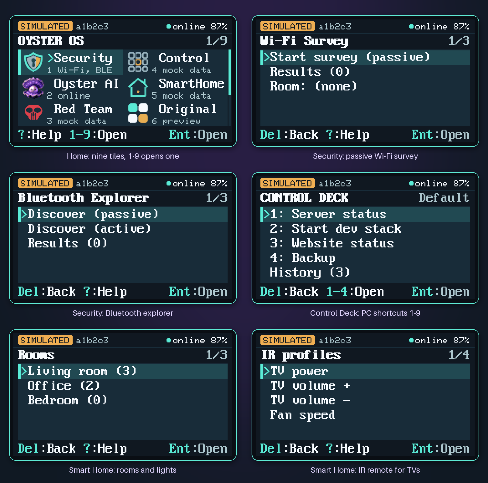
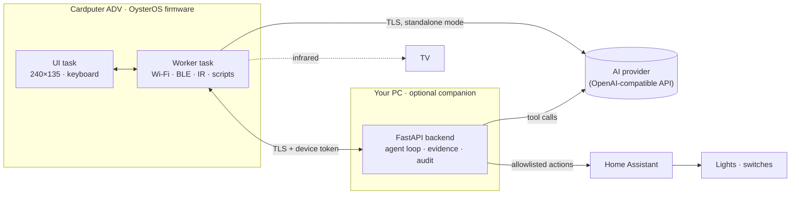

<p align="center">
  
</p>

<p align="center">
  <b>A keyboard-first pocket operating system for the M5Stack Cardputer ADV:</b><br>
  Wi-Fi and Bluetooth recon, an AI assistant that answers over its own Wi-Fi, smart-home and PC control,
  on-device Python scripting, and an offline calculator — on a 240 × 135 screen.
</p>

<p align="center">
  
  
  
  
  
</p>

---

**OysterOS** is a complete firmware plus companion stack that turns the
[M5Stack Cardputer ADV](https://docs.m5stack.com/en/core/Cardputer-Adv) (an ESP32-S3 with a tiny keyboard and screen) into a
pocket terminal. It boots to its own home screen, joins your Wi-Fi by itself, and works **standalone** —
the laptop backend is an optional power-up, not a requirement.

The project covers the whole chain: C++ firmware with a custom UI toolkit, a Python companion backend,
an AI agent loop with typed tools, a pixel-accurate screen simulator, provisioning over USB serial, and
about 2,500 automated tests (2,081 Python, 426 firmware unit tests).

## Contents

- [The screens](#the-screens)
- [What each tile does](#what-each-tile-does)
- [How it fits together](#how-it-fits-together)
- [Lighting control](#lighting-control)
- [Interesting facts](#interesting-facts)
- [What runs on real hardware today](#what-runs-on-real-hardware-today)
- [Getting started](#getting-started)
- [Repository map](#repository-map)
- [Scope and safety](#scope-and-safety)
- [Documentation](#documentation)

## The screens

<p align="center">
  
</p>

<sub>Rendered by the project's own 240 × 135 simulator (hence the <code>SIMULATED</code> badge and demo data) —
the same layout, fonts and colour tokens the firmware draws. Midnight navy, slate panels, a seafoam focus
stripe, amber for warnings. The whole UI is painted through <b>one 240 × 16 pixel strip</b>; there is no
full-screen framebuffer.</sub>

## What each tile does

Home is a two-column grid of nine tiles. Arrow keys move, <kbd>Enter</kbd> opens, <kbd>1</kbd>–<kbd>9</kbd>
jump straight to a tile, <kbd>?</kbd> shows help, and the **G0** button locks the screen back to the animated
mascot.

| | Tile | What it does | Needs the PC? |
|:-:|---|---|:-:|
|  | **1 · Security** | Passive **Wi-Fi survey** (channels, signal, encryption) and a **Bluetooth LE explorer** (discover, inspect GATT services of your own lab devices). Findings are saved as evidence. | No |
|  | **2 · Oyster AI** | Ask a question on the keyboard (or by voice through the backend). The answer comes **directly from the AI provider over the device's own Wi-Fi**; with the backend running, the AI can also call tools that make the Cardputer scan for it. | No |
|  | **3 · Red Team** | A sandboxed **Python interpreter** (PikaPython) on the device: run the built-in example or any `.py` from the SD card, with an `Oyster` module for logging and reading scan results. Also points to the separate offensive firmware for this board. | No |
|  | **4 · Control** | A **Stream-Deck-style panel for your PC**: slots 1–9 run allowlisted actions (media keys, lock, Wake-on-LAN, service restart). Impactful slots need a confirmation on the device. | Yes |
|  | **5 · Smart Home** | An **IR remote** for five TV families from the Cardputer's own IR LED, plus **lights, switches and locks through Home Assistant** — see [Lighting control](#lighting-control). | IR: no · HA: yes |
|  | **6 · Original** | Explains how to go back to the factory firmware: one script restores the verified backup of your own chip, another brings OysterOS back. | — |
|  | **9 · Scratchpad** | An **offline calculator and notepad**. A big mint result display, amber operators, a history tape. Lives in RAM only: nothing is stored, nothing is sent. | No |
|  | **7 · Settings** | Join a Wi-Fi network from the keyboard, brightness, storage, diagnostics, a key tester and the status-LED colour legend. | No |
| | **8 · Help** | Every key, every screen, and what the LED colours mean. | No |

## How it fits together



- **Standalone:** the Cardputer holds its own Wi-Fi credentials and AI key, keeps the link up, and talks
  TLS straight to the AI provider. No laptop involved.
- **With the companion:** the backend runs an **agent loop**. The model never touches the radio: it can only
  request typed tools (`wifi_survey`, `ble_discover`, `ble_inspect_gatt`, ...). The backend validates each
  request against a schema, turns it into a job, the Cardputer executes it and sends the result back,
  and the model writes its answer from real data. Anything that changes a device's state needs a
  **physical key press on the Cardputer**.

## Lighting control

The **Smart Home** tile lists your rooms and lights from Home Assistant and turns them on and off from the
keyboard; the toast shows the state Home Assistant reports back, never a guess. Locks, covers and alarm
panels open a confirmation page first, and every action is written to an audit log.

**Hooking up Wi-Fi lights (example: Hama Smart Home)** — Hama's Wi-Fi bulbs are built on Tuya:

1. Pair the lights in the **Smart Life** (Tuya) app instead of the Hama app — Home Assistant's Tuya
   integration can read Smart Life accounts.
2. In Home Assistant add the **Tuya** integration and log in by scanning its QR code with Smart Life.
3. Create a long-lived access token (Profile → Security) and put the URL and token into `backend/.env`
   (`HOME_ASSISTANT_URL`, `HOME_ASSISTANT_TOKEN`).
4. List the lights you want on the pocket device in an allowlist, starting from
   [`examples/home_allowlist.example.json`](examples/home_allowlist.example.json). Only what is listed can be
   controlled.

Full walkthrough and the verification checklist: [`docs/HOME_ASSISTANT.md`](docs/HOME_ASSISTANT.md).
The Cardputer also has a **WS2812 status LED** that shows the connection state in colour (legend under
Help).

## Interesting facts

- **It's an agent's hands, not its brain.** An LLM can't run on an ESP32-S3 — this one has no PSRAM and
  about 56 KB of free heap at runtime. So the Cardputer is the agent's *sensors and actuators*: the model
  reasons in the cloud, and the pocket device does the scanning and acting through a strict tool interface.
- **Could the model live on the SD card?** Not a language model: even the smallest useful ones need
  hundreds of megabytes of RAM, which is thousands of times what this chip has. What *does* work is moving
  the brain closer: the backend speaks the OpenAI-compatible API, so it can point at a model running on
  your own PC (llama.cpp, Ollama, LM Studio, …) — then the **whole agentic pipeline runs inside your
  home network** with the Cardputer as its field device (supported by design, not yet tested with a local
  model). The SD card's job is scripts and evidence: drop a `.py` into `/oyster/scripts/` and the device
  runs it.
- **TLS on a shoestring.** mbedTLS wants 16 KB in + 16 KB out per connection, and the buffers can't be
  shrunk in this framework. Making the standalone AI work meant freeing about 8 KB of internal RAM so the
  hardware SHA engine could verify the provider's elliptic-curve certificate chain.
- **One strip, whole UI.** Every screen region is drawn through a single 240 × 16 sprite (7,680 bytes)
  instead of a 64 KB framebuffer. Nothing animates unless the screen actually changed — except the
  mascot's 6 fps loader on the lock screen.
- **The original firmware is never lost.** The flash script refuses to write a chip that has no verified
  full backup of *that exact chip*. An attempt to dual-boot the factory firmware on the device was tested
  and documented as impossible (an ESP-IDF 5 app cannot be loaded by an ESP-IDF 4 bootloader, and the chip
  has one bootloader slot), so restoring is a one-command PC step instead.
- **A simulator that tests the firmware's UI.** The Python simulator renders all 41 screens in five states;
  parity tests check that its tiles, footers and key hints match the C++ firmware.
- **Scripts can't brick the device.** The Python sandbox has no network or file access beyond its one
  script, every sleep is capped and cancellable, and all of the interpreter's file hooks fail closed
  instead of hanging.

## What runs on real hardware today

Verified on the Cardputer ADV:

- Boot, splash and lock screen, keyboard, battery indicator, status LED
- Wi-Fi auto-connect with a separate **ONLINE / Wi-Fi** indicator, joining networks from Settings
- **Oyster AI answering with the laptop switched off** (direct over Wi-Fi), and through the backend
- USB serial provisioning, TLS with a per-device token to the backend
- Wi-Fi survey and BLE discovery triggered by an AI question

Written and tested on the PC, **not yet tried on the device**: Control Deck actions, the IR remote and the
Home Assistant bridge, Python scripts (Red Team), push-to-talk voice and the Scratchpad. The honest,
row-by-row state is in [`docs/CAPABILITY_MATRIX.md`](docs/CAPABILITY_MATRIX.md) and
[`docs/HARDWARE_VERIFICATION.md`](docs/HARDWARE_VERIFICATION.md).

## Getting started

Windows and PowerShell, from the repository root. The full walkthrough is
[`docs/SETUP_WINDOWS.md`](docs/SETUP_WINDOWS.md).

```powershell
.\scripts\setup.ps1          # tools and Python environment
.\scripts\check.ps1          # lint, ~2,500 tests, firmware build - no device needed
.\scripts\ui-sim.ps1         # click through every screen on the PC
```

On the device (back up first — the flash script insists):

```powershell
.\scripts\firmware-backup.ps1 -Port COM5                          # full 8 MB backup of your chip
.\scripts\firmware-flash.ps1  -Port COM5 -Env cardputer-adv-dualboot
.\scripts\oyster-up.ps1                                           # provision Wi-Fi + AI key, start the backend
```

Back to the factory firmware at any time: `.\scripts\original-restore.ps1 -Port COM5`.

## Repository map

| Folder | What lives there |
|---|---|
| [`firmware/`](firmware/) | PlatformIO project: the UI, modules (one file per tile), radio and TLS clients, and `lib/oyster_core` — portable logic with host-side unit tests |
| [`backend/`](backend/) | FastAPI companion: agent loop and tool catalogue, evidence store, Control Deck, Home Assistant bridge, voice transcription, provisioning CLI |
| [`simulator/`](simulator/) | The 240 × 135 UI simulator (headless PNG renders or a desktop window) |
| [`lab/`](lab/) | A simulated device and a BLE lab fixture for testing without hardware |
| [`schemas/`](schemas/) | JSON schemas shared by firmware, backend and tests |
| [`scripts/`](scripts/) | Setup, gate, build, backup, flash, restore, provisioning |
| [`tests/`](tests/) | Python tests (backend, simulator, assets, contracts) |
| [`docs/`](docs/) | Design system, architecture, decisions (`docs/adr/`), setup and verification guides |
| [`assets/`](assets/) | Mascot, icons, loader animation and their [provenance](assets/PROVENANCE.md) |

## Scope and safety

OysterOS is built for learning and for testing **your own** equipment. It does passive recon, inspection
of devices you have enrolled, and automation of systems you own. It deliberately **does not** include
tools that disrupt or deceive other people's devices — no deauthentication, beacon spam, Karma or
credential-harvesting portals; in radio range their effect can't be limited to your own gear.

Secrets stay out of the repository: the AI key lives in `backend/.env` and, for standalone mode, in the
device's internal NVS storage — never in source, logs or on the SD card. What the AI provider receives is listed in
[`docs/PRIVACY.md`](docs/PRIVACY.md).

## Documentation

| Read | For |
|---|---|
| [`docs/ARCHITECTURE.md`](docs/ARCHITECTURE.md) | How firmware, backend and simulator fit together |
| [`docs/DESIGN_SYSTEM.md`](docs/DESIGN_SYSTEM.md) | Colour tokens, type, spacing and components of the UI |
| [`docs/UI_SCREEN_MAP.md`](docs/UI_SCREEN_MAP.md) | Every screen, the navigation tree and the keys |
| [`docs/CAPABILITY_MATRIX.md`](docs/CAPABILITY_MATRIX.md) | What works where, and what doesn't exist |
| [`docs/HOME_ASSISTANT.md`](docs/HOME_ASSISTANT.md) | Smart Home: lights, IR remote, allowlist |
| [`docs/CONTROL_DECK.md`](docs/CONTROL_DECK.md) | PC shortcuts and their safety rules |
| [`docs/SCRIPTS.md`](docs/SCRIPTS.md) | The on-device Python sandbox and its `Oyster` module |
| [`docs/VOICE_INPUT.md`](docs/VOICE_INPUT.md), [`docs/WEB_ACCESS.md`](docs/WEB_ACCESS.md) | Voice questions, optional web search for the AI |
| [`docs/DUAL_BOOT.md`](docs/DUAL_BOOT.md) | The original firmware: why on-device dual boot fails, how restore works |
| [`docs/SETUP_WINDOWS.md`](docs/SETUP_WINDOWS.md), [`docs/TROUBLESHOOTING.md`](docs/TROUBLESHOOTING.md) | Setup, flashing, COM ports, certificates |
| [`docs/OysterOS_Project_Plan.md`](docs/OysterOS_Project_Plan.md), [`docs/DEVELOPMENT_ROADMAP.md`](docs/DEVELOPMENT_ROADMAP.md) | The original product vision and milestones |
| [`docs/adr/`](docs/adr/) | Architecture decision records |

## Credits

Firmware, backend, simulator and design by **martin.matysek**. The mascot is the project's own artwork;
how the icons, banner and loader were made is recorded in [`assets/PROVENANCE.md`](assets/PROVENANCE.md).
Third-party code and licences (including the vendored PikaPython interpreter, MIT) are listed in
[`LICENSE-NOTICES.md`](LICENSE-NOTICES.md).
