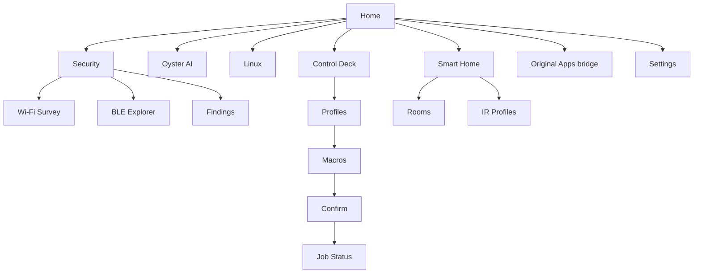

# OysterOS UI/UX Design System

**Target:** 240 × 135 px landscape Cardputer ADV display. **Design state:** approved concept; implementation and exact keys not yet hardware-verified.

## Personality and goals
A tiny but useful pocket operating shell. Dark maritime palette, seafoam highlight, obvious focus, restrained terminal styling, and no dead controls. A beginner must always understand how to go back.

## Design tokens
| Token | Value | Purpose |
|---|---|---|
| Background | `#101923` | root |
| Panel | `#192C3D` | lists and content |
| Focus | `#234B54` | focused row |
| Accent | `#5EEAD4` | active / selection |
| Text | `#F4FAFF` | primary |
| Secondary | `#A9C4CE` | labels |
| Warning | `#E9AD52` | confirmations |
| Error | `#F17A7A` | problems |

### Spatial sizing
- Screen: 240×135
- Safe padding: 5px horizontal
- Status bar: y 0–14
- Heading: y 16–31
- Content: y 33–116, show at most 3–5 actionable rows, scroll the rest
- Action strip: y 119–134
- Fonts: bold 14px heading, 12px body, 10px metadata only when legible on-device
- Selected row has a 3px accent stripe + `>` marker, not just a color change.
- Never truncate important action outcomes; provide scrolling or a detail route.

## UX navigation

Global logical actions: Up, Down, Select, Back, Home, Help. Actual physical bindings must be established by a key-diagnostic tool on the installed launcher; firmware keys may differ. Back closes modal or pops navigation; Home always returns to OysterOS root. Number shortcuts only when the screen advertises them.

## Required components
`StatusBar`, `AppHeader`, `MenuList`, `FocusRow`, `DetailsView`, `InputEditor`, `Alert`, `ConfirmDialog`, `Spinner`, `JobProgress`, `OfflineState`, `HelpOverlay`, `ConnectionStatus`, `FooterHints`.

### UI states
Every backend-connected view must represent: loading, ready, empty, offline, unauthorized, and error. Job screens additionally show queued, executing, success, failure, timed out, canceled, or status unknown. Never claim that an IR command succeeded at the appliance level without device feedback.

## Program-specific look and flow

### Security
Seafoam when scan running, sortable list of Wi-Fi SSID/channel/RSSI or BLE name/RSSI, inspected detail card, Save/Explain actions. Disclose when observations are cached and timestamped. Avoid showing identifiers to hosted AI without review.

### Oyster AI
Two-pane concept translated to sequential tiny-screen states: composer → processing → paged answer. Text first, voice later. Each output page shows line number and scroll hint. “Explain finding” starts with a context-preview confirmation.

### Linux
Host picker with online/offline indicator → host overview → health/services/logs → approved task listing. Host selection persists. Read-only inspection never requires confirmation; state-changing actions do.

### Smart Control Deck
Profile badge in header; macros displayed as `1: Server Status`, etc. Slot press opens summary, then confirm if needed. Distinguish *scheduled*, *queued*, *running*, *complete* from one another. Show job ID and retry only with idempotency checks.

### Smart Home
Room picker → device list → state and control. Infrared controls require profile setup. Home Assistant integrations show a connected state or an installation message; no fabricated state.

### Original Apps
Always visible from OysterOS Home. Invokes genuine original launcher **only after integration verified**. Before then show “Original launcher integration unavailable in simulator”. Preserve apps and settings; never copy UI and claim original firmware survived.

### Settings and Keyboard Help
Device status, Wi-Fi/pairing, firmware info, host pairing, input diagnostics, and About. Key tester screen displays physical event and resolved logical action, useful for validating Esc and Home.

## Mockup screen IDs
- H01 Home
- S10 Security module
- S11 Wi-Fi scan / S12 Wi-Fi results / S13 Detail
- S21 BLE scan / S22 results / S23 Detail
- A10 AI compose / A11 working / A12 answer
- L10 host selection / L11 overview / L12 services / L13 logs
- D10 deck profile / D11 macro details / D20 confirmation / D21 running / D22 history
- SH10 rooms / SH11 device / SH12 IR
- O10 Original Apps entry
- P10 Settings / P11 key diagnostics

## UI test checklist
- [ ] Every leaf route exits with Back
- [ ] Every route exits with Home
- [ ] Scrolling never hides the focused item
- [ ] Text editor handles Backspace and Cancel
- [ ] All jobs have a failure state
- [ ] Connected labels derive from actual connectivity
- [ ] No fake functional toggles
- [ ] Long SSIDs / BLE names are safely clipped
- [ ] Zero-scan results handled
- [ ] Show a clearly disabled state for unfinished modules
