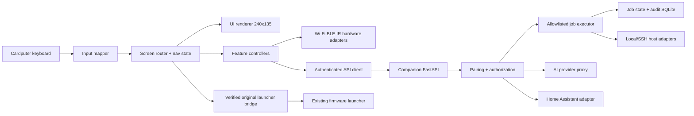

[OysterOS](../README.md) / [Docs](README.md) / Project plan

# OysterOS Engineering Plan — v0.3

**Status:** design record. This is the original product and engineering plan, written before implementation; the system as built is described in [`ARCHITECTURE.md`](ARCHITECTURE.md) and the [README](../README.md). **Target:** M5Stack Cardputer ADV. **Priority:** preserve installed applications and existing launcher.

## 0. Non-negotiable constraints

1. **Do not flash, erase, repartition or replace existing firmware until inventoried, backed up where technically possible, and user-approved.**
2. The genuine original apps (Compass, voice, PikaScript, GPS-labelled tools, etc.) must remain accessible. Do not reproduce those interfaces as fake placeholders.
3. The Cardputer is an ESP32-S3 microcontroller, not a Linux computer. Linux tasks happen through an authenticated companion on another machine.
4. GPS capability is dependent on attached hardware and current firmware; do not claim the ADV has onboard GPS.
5. Each visible action must have a defined command, lifecycle, result, failure view and acceptance test. Incomplete features must be visibly marked unavailable.
6. Scope security tools to passive scanning and authorized diagnostics.

## 1. Architecture decision record: coexistence first

**Phase 0 inventory:** record exact board revision, installed firmware and version, boot sequence, visible apps, configuration, flash layout, launcher/app loading mechanism, USB serial behavior, and recovery options. Photograph menus. Research SDK and launcher APIs for installing an app/package. Capture any available verified official firmware source or backups. A raw flash dump may contain private settings/keys: keep local and out of Git.

**Preferred option A:** OysterOS as an application within the existing firmware/launcher, with clean return path.

**Fallback option B:** existing firmware-compatible multiboot / launcher feature, verified on this hardware with recoverable images.

**Fallback option C:** self-contained separate OysterOS firmware only after explicit approval, backup and a proven recovery path. In this case original firmware and apps may not be simultaneously present: label limitation plainly; do not claim otherwise.

**Gate P0:** an on-device demonstration opens OysterOS from existing menu and returns to original app menu without loss of programs or settings. Until this passes, develop desktop UI simulator + companion only.

## 2. Computer science learning outcomes

Modular embedded architecture; finite-state machines; input event processing; asynchronous I/O; API authentication and access control; persistence and schema versioning; test-driven UI flows; resource constraints; fault tolerance; secure remote execution.

## 3. Visual language and rendering contract

Target physical viewport **240x135 landscape**. Safe margins 4–6 pixels; 12–14px key labels when font permits; selected list row emphasized with seafoam accent (#5EEAD4). Colors: shell #101923, panels #192C3D, primary #F4FAFF, muted #A9C4CE, warning #E9AD52, error #F17A7A.

**UI primitives:** StatusBar; Header; MenuRow; ScrollList; DetailRow; LoadingView; EmptyState; Toast; ConfirmModal; KeyboardHelp; ResultPanel; ProgressView; ErrorPanel. Use dirty-rectangle or bounded redraws to limit flicker; don't block the event loop for network calls.

**Layout:** persistent 12–16px status bar; remaining space for title and 3–5 visible focusable rows; bottom help strip as space permits. Long results paginate/scroll. Always show *Disconnected* / *No results* / *Permission denied* states.

### Screen map
| Route | Subscreens | Primary action |
|---|---|---|
| /home | list/dashboard | select destination |
| /security | /wifi, /ble, /findings | start passive scan |
| /security/wifi | /scan, /results, /detail | scan then inspect SSID/RSSI/channel/security |
| /security/ble | /scan, /results, /detail | BLE advertisements and authorized characteristics |
| /ai | /compose, /pending, /answer | type question, send to companion, read paged response |
| /linux | /hosts, /host/:id, /tasks, /result | get health/logs, run approved tasks |
| /deck | /profiles, /profile/:id, /macro/:id, /run/:id | choose macro, parameterize, confirm, execute |
| /home-control | /rooms, /device/:id, /scenes | display device state; authorized control |
| /original | /unavailable | invoke verified original launcher adapter |
| /settings | /network, /pairing, /keyboard, /about | configure and diagnose |

### UI interaction states

`IDLE → LOADING → SUCCESS | EMPTY | ERROR | OFFLINE`

Dangerous operations: `READY → CONFIRM → QUEUED → RUNNING → SUCCESS | FAILED | TIMED_OUT | CANCELLED`.
UI should never report success before a backend acknowledgement.

## 4. Keyboard mapping & Back/Home

Separate **physical key mapping** from **logical actions**:
- `MOVE_UP`, `MOVE_DOWN`, `MOVE_LEFT`, `MOVE_RIGHT`
- `SELECT`, `BACK`, `HOME`, `HELP`, `TEXT_INPUT`, `SHORTCUT_1..9`
- `CANCEL`, `CONFIRM`

Exact `Fn` / `Esc` combos must be experimentally verified on device; avoid hardcoding untested key assumptions. Proposed Back=Escape, Home=Fn+Backspace **only once validated**; provide Settings > Keyboard with displayed and remappable bindings if feasible.

Input architecture: poll/interrupt → debounce → map to logical event → global navigation handler → active screen handler → redraw.

**Global invariants:** BACK closes modal first, otherwise pops navigation stack; HOME goes to OysterOS root; no action traps user; long-running task remains cancellable; original launcher switch uses verified firmware mechanism only.

## 5. Module wiring

### Wi-Fi Surveyor
`ENTER` on scan → hardware scan adapter → results sorted by RSSI → select network → detail view → save findings cache → optionally send sanitized scan summary to AI. Never require packet injection or connection attempts for MVP.

### BLE Explorer
Start scan → BLE advertisement callback → bounded deduplicated list → detail → optionally enumerate authorized GATT services on devices the user owns → disconnect cleanly. Explicit “permission/authorized use” warning.

### Oyster AI
Compose text on Cardputer → validate length → HTTPS authenticated POST to companion → AI provider proxy → show answer in paged view. Backend holds API key. For scan interpretation: user chooses **Explain this result**; context shared is shown first. Voice = later milestone with mic recording, transfer, transcription, answer and optional playback.

### Linux Console
Host list from companion → health (CPU/memory/disk/service status) → details and logs; task menu from backend allowlist. Avoid arbitrary shell input as default. Backend connects via SSH with host key verification or local OS adapters; non-root service account; command arguments validated and encoded safely, no shell-string concatenation. Action jobs return IDs and status.

### Smart Control Deck
A profile contains configurable slots (`1..9`) bound to `macro_id`. Macro contains ordered or conditional approved steps such as GET_SERVER_STATUS, START_DEV_STACK, RUN_BACKUP, HOME_SCENE. Every step is a typed backend action, with permissions, timeout, retry policy and an optional confirmation requirement.

Flow: select profile → shortcut → summary/preflight → confirmation if impactful → POST /jobs → poll /jobs/{id} → final result/history. No automatic blind repeats of dangerous actions. Network failures must show whether execution status is **unknown**, to prevent double runs.

### Smart Home
IR emitter: verified IR codes/protocols for owned devices; selectable profiles. Companion: Home Assistant API/MQTT via credentials stored only on companion; read device state before showing toggles; handle unavailable integrations without fake UI success.

### Original Apps
Adapter interface: `available(): bool`, `launch_original(): Result`, `return_supported(): bool`. Implement only after current firmware is documented. If unsupported, show explanatory disabled state; never overwrite flash as implicit navigation.

## 6. Companion service design

Suggested stack: Python 3.12+, FastAPI, SQLite, typed models, APScheduler or equivalent. Run under dedicated unprivileged account.

### API v1 (illustrative; not yet implemented)
| Method | Route | Request | Response |
|---|---|---|---|
| GET | /v1/health | — | online, version, capabilities |
| POST | /v1/pair | short-lived pairing proof | scoped device credential |
| GET | /v1/hosts | — | filtered host list |
| GET | /v1/hosts/{id}/health | — | CPU/memory/disk/service states |
| GET | /v1/hosts/{id}/logs | cursor, source, count | redacted entries |
| GET | /v1/deck/profiles | — | profile, slot and macro summaries |
| POST | /v1/jobs | macro_id, input, idempotency_key | job_id, state |
| GET | /v1/jobs/{id} | — | status, sanitized output, timestamps |
| POST | /v1/jobs/{id}/cancel | — | accepted or not cancellable |
| GET | /v1/jobs | cursor | bounded job history |
| POST | /v1/ai/query | question, optional reviewed context | answer |
| GET | /v1/home/devices | — | configured targets and state |
| POST | /v1/home/actions | target_id, approved action | job/result |

Authentication: unique device identity, short-lived pairing setup, transport encryption, token rotation/revocation, backend authorization per macro; don't trust client-supplied command templates. HTTP-only development may be restricted to loopback emulator; device deployments require encrypted, authenticated transport or separately documented secure tunnel.

Jobs table: `id, type, macro_id, requested_by, idempotency_key, state, started_at, completed_at, result_redacted, error_code`.
Macros table: `id, name, steps_json, capabilities, confirm_policy, enabled, updated_at`.
Profiles table: `id, name, slot_mapping_json, updated_at`.
Audit table: `timestamp, actor, target, action, decision, job_id`.

### Automation scheduler
Scheduled trigger → authorization/allowlist validation → job queue → step execution → persisted outcome. Schedules run on companion even when Cardputer is off. Editing/deleting schedules requires authentication, and the UI distinguishes **scheduled** from **executed**. Duplicate prevention via idempotency key. No arbitrary AI-generated commands run without user review.

## 7. Repository layout (target, not implemented)
```text
OysterOS/
├── README.md
├── docs/
│   ├── OysterOS_Project_Plan.md
│   ├── hardware-inventory.md       # after firmware audit
│   ├── architecture-decisions/
│   └── ui-screens.md
├── firmware/
│   ├── platformio.ini              # only after SDK selection
│   ├── src/
│   │   ├── app/
│   │   ├── input/
│   │   ├── ui/
│   │   ├── modules/
│   │   ├── drivers/
│   │   └── services/
│   └── test/
├── companion/
│   ├── app/
│   │   ├── api/
│   │   ├── auth/
│   │   ├── jobs/
│   │   ├── adapters/
│   │   └── persistence/
│   └── tests/
├── simulator/
└── .github/workflows/
```

## 8. Delivery milestones, definition of done

**M0 — Inventory and preservation:** documented existing firmware and apps, demonstrated backup/recovery options, validated launcher coexistence method. **No device flashing before this.**

**M1 — Functional shell in simulator:** pixel-appropriate UI, navigation stack, focus, keyboard mapping, Back/Home/Help, mock adapters clearly labelled; unit tests for escape from every route.

**M2 — Original launcher + device navigation:** integrate supported launcher mechanism; verify real original apps still launch and return; measure keyboard latency and reboot behavior.

**M3 — Hardware scanners:** Wi-Fi and BLE lists/details/saved findings; test with radios disabled, zero results, duplicate results, limited memory, scans interrupted.

**M4 — Companion:** explicit pairing, offline recovery, read-only host health/logs and capability negotiation.

**M5 — Deck + Linux jobs:** profile slots, confirmed allowed task execution, idempotency, running/failure/cancel/history screens; command injection and authorization tests.

**M6 — Home + automation:** IR profile, home provider adapter, scheduled workflows, history; test unavailable devices and companion reboot.

**M7 — AI:** question/answer, bounded contextual explanations; optional voice only after robust text interface.

### Acceptance criteria
- No application leaves user unable to return Home.
- Original firmware/apps remain intact according to the chosen verified coexistence strategy.
- Every displayed control has a tested event handler or visible unimplemented state.
- No unverified success toast.
- No secrets embedded in firmware image or Git repository.
- Tests cover no Wi-Fi, companion offline, pairing expiry, repeated button press, power interruption, malformed API data, and cancellation.
- RAM/flash/build footprint tracked against actual Cardputer ADV board revision.

## 9. First coding agent task

1. **Do not flash the hardware.** Inspect this repository and produce a desktop simulator for 240x135 screen routes matching the README.
2. Implement reusable UI widgets, focus/navigation stack, global Back/Home, loading/error/modals and keyboard test cases.
3. Stub controllers behind clean interfaces, and label unimplemented capabilities.
4. Create a read-only local mock companion API for host status and macros; no command execution.
5. Request an **actual screenshot/photo of existing firmware home screen** before writing launcher integration code.
6. Publish screenshots and a traceability matrix: each menu → route → action → handler → result view → automated test.

**Success means functioning architecture and preserved software, not an attractive menu full of dead buttons.**


---

## 10. Product specification v0.4 — real end-to-end interactions

This is a **student-scale computer science project** with an incremental usable deliverable. A screen is considered finished only when the route, domain command, physical driver/companion response, and fallback/error state all work.

### 10.1 Event contract and UI navigation wiring

All screens implement a common interface:

```cpp
struct Screen {
  void onEnter(const RouteParams&);
  void handle(const InputEvent&);
  void update(uint32_t nowMs);
  void render(Display&);
  void onExit();
};
```

The shell maintains a **bounded** navigation stack and one modal layer. Input events are edge-triggered; held keys use explicit repeat delays. Modal `BACK` cancels; a running remote job remains visible in history after navigating away. No screen owns the global HOME handler. If HOME cannot be bound on the existing launcher, document the limitation and implement a visible soft Home entry on each screen.

**Screen-to-service traceability**:

| User action | UI module | Service/driver | Visible result | Recovery |
|---|---|---|---|---|
| Select Wi-Fi scan | Security.WiFi | ESP32 WiFi scan | Access point list / count | timeout and retry |
| Inspect access point | Security.WiFi.Detail | cached AP observation | SSID/BSSID/channel/RSSI/auth | Back to list |
| Select BLE scan | Security.BLE | BLE scanner | discovered advertisements | stop scan, empty result |
| Ask AI question | AI.Compose | companion AI proxy | answer pager | offline/timeout state |
| Check Linux CPU | Linux.Health | GET host health | usage, timestamp, stale marker | choose another host |
| Run deck macro | Deck.Run | POST job with idempotency key | confirmation, progress, output | look up status, do not double-run |
| Toggle smart device | Home.Device | companion integration | acknowledged actual state | retry with fresh state |
| Execute IR code | Home.IR | onboard IR emitter | transmit status, not claimed device success | repeat only on deliberate press |
| Launch original apps | OriginalLauncher | verified launcher bridge | genuine original launcher | explanatory unavailable state |

### 10.2 Concrete UI flows

**A. Wi-Fi diagnostics:** Home > Security > Wi-Fi > Scan > Results > Detail > Save Finding > (optional) Explain with Oyster AI. Use observation timestamps, sanitized labels, network privacy notice, bounded cache. No cracking, deauthentication or intrusive radio behavior in MVP.

**B. BLE inventory:** Home > Security > BLE > Scan > Results > Device > GATT (only if owned/authorized) > Save. Show both random/public address semantics when reported; addresses may rotate and signal strength fluctuates.

**C. Linux control:** Home > Linux > Pick host > System Health > Services > Details. A task requires Home > Linux > Approved tasks > Confirm (for state-changing) > Running > Result. Never treat a process being queued as successful.

**D. Smart macro:** Home > Control Deck > Profile > Slot 1 > Macro summary > Confirmation (when needed) > Job progress > Result. If Wi-Fi drops after POST: show 'status unknown', reconcile via same idempotency key before trying again.

**E. Automation schedule:** Control Deck > Automations > Schedule list > Details > Enable/disable > Backend acknowledgment. Editing new schedules may be companion web UI for MVP; device can monitor and trigger preconfigured ones.

**F. Voice:** Home > Oyster AI > Record > waveform/recording indicator > upload/transcribe > confirmation of recognized text > AI answer. Ship after text input works. Audio data retention policy must be visible.

**G. Original apps:** Home > Original Apps > 'Switch to original launcher?' > verified firmware API > actual launcher. If original software cannot coexist in the same flash setup, the UI must not advertise seamless switching.

## 11. Visual design system — implementation-ready

### 11.1 Layout anatomy (240 × 135)

- Main surface 240 × 135 landscape; top status region y=0..14; title y=16..31; content y=33..116; contextual footer y=119..134.
- Horizontal safe inset 5px. Do not render tiny multi-column dashboards that reduce focusability.
- Default text 12px-equivalent bitmap font; key titles 14px-equivalent; metadata 10px minimum only where legible. Verify with photographs on the physical device.
- A selected row uses a seafoam left bar (3px), tinted navy background, white label; disabled row uses muted text and 'Unavailable' suffix.
- Animations <= 150ms and never block scan, Wi-Fi, keyboard or watchdog servicing.
- Icons should be simple monochrome bitmaps or vector-to-bitmap build artifacts. No network-fetched UI assets on device.

### 11.2 UI component specifications

| Component | Display | Interaction |
|---|---|---|
| StatusBar | title or brand, connection icon, battery if available | no focus |
| MenuList | 3–5 entries, scrolling focus, disabled states | Up/Down, Select |
| DetailPanel | property/value pairs | scroll and Back |
| TextEntry | keyboard typed characters, visible caret, character counter | type, Backspace, Submit |
| ConfirmationDialog | operation name, target, risk, Yes/No | default No |
| ProgressPanel | state label, spinner/progress if known, elapsed | Cancel if permitted |
| Notification | short acknowledgement/failure | dismiss after user action |
| HelpOverlay | physical keys and controls per route | Back dismiss |
| OfflineView | companion offline, last-seen time | Retry or Back |
| OriginalLauncherBridge | verified integration only | explicit transition |

### 11.3 Color and accessibility

| Token | Hex | Use |
|---|---|---|
| `surface.base` | `#101923` | shell |
| `surface.panel` | `#192C3D` | cards/list |
| `surface.focus` | `#234B54` | selected row |
| `text.primary` | `#F4FAFF` | high legibility |
| `text.muted` | `#A9C4CE` | supporting text |
| `accent` | `#5EEAD4` | selected/connected |
| `warning` | `#E9AD52` | confirmation/wait |
| `error` | `#F17A7A` | error and destructive intent |

Focus should not rely solely on color: add selector glyph `>` and outline. Keyboard help is always one action away. A 'large text' option can reduce visible rows.

### 11.4 Wireframes and screen identifiers

```text
HOME [H01]                      WIFI RESULTS [S12]
+-----------------------------+  +-----------------------------+
| OYSTER OS       WiFi  BAT   |  | WI-FI SURVEY       12 APs   |
|-----------------------------|  |-----------------------------|
| >1 Security    4 Control   |  | >OfficeWiFi       -54 dBm   |
|  2 Oyster AI   5 SmartHome |  |  Guest            -72 dBm   |
|  3 Linux       6 Original  |  |  IoT              -81 dBm   |
|-----------------------------|  |-----------------------------|
| Back Help       Enter Open |  | Back      Enter Inspect     |
+-----------------------------+  +-----------------------------+

DECK [D10]                     JOB [D20]
+-----------------------------+  +-----------------------------+
| CONTROL DECK     HOME       |  | START DEV STACK             |
|-----------------------------|  |-----------------------------|
| >1 Server status            |  | Host: MINI-PC               |
|  2 Start dev stack          |  | Impact: starts services     |
|  3 Red Orca status          |  | Confirm execution?          |
|  4 Backup                  |  | >No          Yes            |
|-----------------------------|  |-----------------------------|
| Back              Run      |  | Back          Enter         |
+-----------------------------+  +-----------------------------+

LINUX [L10]                    AI [A10]
+-----------------------------+  +-----------------------------+
| LINUX       MINI-PC  ONLINE |  | OYSTER AI          ONLINE   |
|-----------------------------|  |-----------------------------|
| > System health             |  | Ask a question              |
|   Services                  |  | >                           |
|   Logs                      |  |                             |
|   Approved tasks            |  |                             |
|-----------------------------|  |-----------------------------|
| Back            Inspect    |  | Back         Enter Send     |
+-----------------------------+  +-----------------------------+
```

### 11.5 Consistency rules

- All back footers have the same semantics; no special unannounced escape keys.
- All network requests show *connecting*, timeout and retry.
- Input focus persists when a list refreshes when possible.
- Never place a destructive task directly on a single unconfirmed numbered shortcut.
- App names use consistent nouns in README, route names and code.

## 12. Architecture and boundaries



**Boundary rules:** The ESP32 never holds long-lived third-party API keys. Companion endpoints validate requests independently of device UI. The server decides which macros exist and may run. Health probes and jobs use typed payloads with schema validation and version negotiation. Store pairing keys via best available secure storage and provide revocation.

## 13. Project structure and deliverables

Build this as a **monorepo** with separately testable packages:

```text
/
  README.md
  docs/
    OysterOS_Project_Plan.md
    DESIGN_SYSTEM.md
    HARDWARE_AUDIT_TEMPLATE.md
  simulator/
    README.md
    src/              # pixel-sized UI and keyboard emulation
    tests/
  firmware/
    README.md         # choose SDK after audit
    src/
      core/           # routing + events
      features/       # modules/controllers
      drivers/        # screen, keyboard, radios
      transport/
    tests/
  companion/
    README.md
    app/
      api/
      auth/
      schemas/
      adapters/
      automation/
      jobs/
      storage/
    tests/
  .github/workflows/
```

**Coding-agent task ordering:**
1. Implement simulator (no hardware write), with screenshots corresponding to design IDs.
2. Add executable screen/navigation tests.
3. Implement companion mock endpoints and job state simulator.
4. Complete hardware audit & preservation proof, then select the device SDK.
5. Connect first real hardware feature (Wi-Fi scan).
6. Integrate companion with a read-only Linux health command.
7. Add explicit allowlisted tasks and scheduled automation.
8. Add BLE, Smart Home, and AI progressively.

## 14. Measurable acceptance tests

| Test ID | Given | Action | Pass condition |
|---|---|---|---|
| NAV-01 | any leaf screen | Back | returns to parent |
| NAV-02 | any screen | Home | returns to root |
| NAV-03 | confirm modal shown | Back | dismisses without execution |
| SEC-01 | Wi-Fi radio on | scan | results shown, no crash |
| SEC-02 | no APs | scan | shows empty state |
| NET-01 | companion offline | select Linux | explanatory offline view |
| JOB-01 | authorized macro | run | job_id and final status displayed |
| JOB-02 | unauthorized macro | run | denied, audit entry |
| JOB-03 | connection lost after POST | reload status | no automatic duplicate execution |
| HOME-01 | smart device unavailable | toggle | no false success indicator |
| AI-01 | empty question | submit | validation, no request |
| ORIG-01 | original launcher bridge unavailable | choose Original Apps | explicit unavailable state |
| ORIG-02 | integration verified | switch | real existing app menu appears |
| PRES-01 | device pre/post-install | compare app inventory | original programs and configuration preserved |

## 15. Constraints and decision gates

**Hardware:** The exact feature set, partitioning, battery APIs, key codes and camera/GPS/audio capabilities must be verified against the specific Cardputer ADV and current firmware. A launcher may expose apps differently. Do not claim feature compatibility solely because an app icon exists.

**Release gates:** No flashed build until hardware audit. No remote command execution until authentication, allowlist and audit logs have passing tests. No AI-triggered action without user confirmation, and no passive telemetry upload without opt-in.

**Definition of MVP:** A usable OysterOS shell plus a working Wi-Fi scanner, read-only Linux host status and a configurable Smart Control Deck that triggers one approved companion action safely; original apps preserved via a verified compatible launcher.
